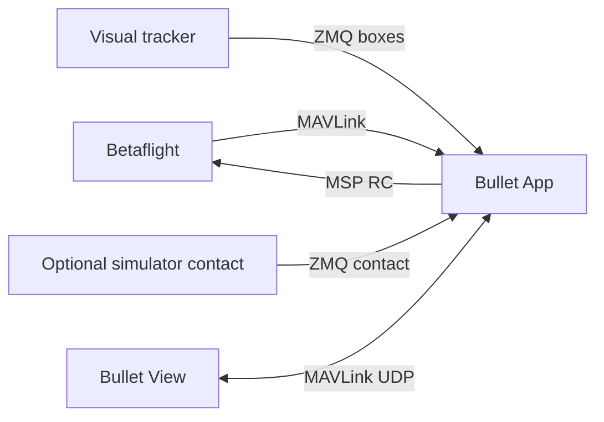

# Bullet App

Bullet App controls Betaflight flights through MAVLink telemetry and MSP RC commands. Current mission behavior and throttle tuning are verified in SITL; serial hardware flight has not been verified.

## Overview

App runs a 50 Hz loop for hover/land or red-truck target-hit. Bullet View sends operator commands and displays App state over a separate MAVLink UDP connection. See the [control loop diagram](docs/mission-control-loop.md).

## Features

- Configurable hover/land mission and timestamped tracker input for target-hit.
- Optional simulator contact confirmation for target-hit, enabled in YAML.
- Manual View approval or one automatic attempt, with telemetry and View loss handling.
- Persistent mission logs with target tracking checkpoints.

## Architecture



The process-wide blackboard holds MAVLink, visual, simulation, and target feature data. Each tick passes it to a mission through `StepContext`. App opens `TrackerSubscriber` for target-hit and imports `SimulationContactSubscriber` only when `simulation.enabled` is true. Both missions use a `transitions` state machine. At startup, App reads `MSP_BOARD_INFO` and reports confirmed SITL in bit 0 of App-to-View `HEARTBEAT.custom_mode`; this identifies the firmware target, not the physics connection.

## Requirements

Python 3.12+, `uv`, and Betaflight MSP and MAVLink links. Manual mode needs Bullet View. Target-hit needs a tracker publisher; simulator contact is optional.

## Installation

From the App checkout, install locked dependencies:

```sh
uv sync --group dev
```

The project uses editable sibling checkouts of `beta_client`, `bullet_simulation_protocol`, and `los_tracking`; see [pyproject.toml](pyproject.toml).

## Quick Start

Start the `bullet_drone` SITL launcher, then App and View in separate terminals:

```sh
cd /home/user/projects/bullet_drone
uv run --frozen --extra sitl --extra mavlink --extra render launcher

cd /home/user/projects/bullet_app
uv run --locked bullet-app --mission hover-land

cd /home/user/projects/bullet_view
uv run --locked bullet-view
```

In the multi-root VS Code workspace, the launcher, App, and View tasks provide the same workflow. Use View to Arm and Start in manual mode. The default hover profile climbs 20 m above launch, hovers 10 continuous seconds, then lands and disarms.

## Usage

### Hover/land

```sh
uv run --locked bullet-app --mode auto --mission hover-land
```

Manual mode is the default and supports another flight after landing. Auto mode starts after fresh feedback and exits after one landing or fault. Change the packaged [hover profile](src/bullet_app/missions/hover_land.yaml) with `--mission-config`.

### Red-truck target-hit

Start the target scene and Bullet Visual, then run:

```sh
uv run --locked bullet-app --config src/bullet_app/app.sitl.yaml --mode manual --mission target-hit
```

The App VS Code mission tasks use this SITL config. The workspace target-hit stack selects it through its launch script. View sends Arm and Start. The drone climbs to the applied height (10 m by default), hovers five seconds, searches, centers, and follows LOS guidance. Tracker boxes are forwarded to View for frame-matched overlays. Validated simulator contact disarms and reports `hit`. Without enabled contact, Commit times out after three seconds and lands with `contact not confirmed`. Target-hit permits one attempt per App process. See the [target-hit guide](docs/target-hit-mission.md).

## Configuration

The bundled [app.yaml](src/bullet_app/app.yaml) selects independent MSP and MAVLink connections and disables simulator contact. The [SITL config](src/bullet_app/app.sitl.yaml) enables it. Copy either file and pass `--config path/to/app.yaml` for another setup; every field is documented beside its value. Select `tcp` or `serial` independently for MSP and MAVLink. Serial MSP uses `device` and `baudrate`; serial MAVLink uses a device `endpoint` and `baudrate`.

| Setting | Default | Use |
| --- | --- | --- |
| `simulation.enabled` | `false` | Open simulator contact only for target-hit when true. |
| `simulation.contact_endpoint` | `tcp://127.0.0.1:5555` in bundled YAML | ZeroMQ contact publisher when enabled. |
| `--contact-endpoint` | None | Override the contact endpoint; requires simulation enabled. |
| `--bbox-endpoint` | `tcp://127.0.0.1:5560` | Tracker boxes for target-hit. |

`--msp-host` and `--msp-port` override TCP MSP YAML values; `--mavlink-endpoint` overrides the MAVLink endpoint. TCP MSP flags are rejected for serial MSP. Omitting the `simulation` section disables contact.

## Project Structure

- `src/bullet_app/app.py`: control loop and connection lifecycle.
- `src/bullet_app/missions/`: shared flight behavior and missions.
- `src/bullet_app/tracker.py`: tracker box subscriber.
- `src/bullet_app/simulation.py`: optional simulator contact subscriber.
- `src/bullet_app/blackboard.py`: current observations and step context.
- `tests/`: App tests; `docs/`: mission guides and diagrams.

## Development

Run App with `uv run --locked bullet-app`; inspect options with `--help`. Each process writes `~/workspaces/bullet_ng/logs/bullet_app_<timestamp>.log` before flight and prints its path. The file includes INFO events and 5 Hz target tracking checkpoints. Logging failure stops startup. No formatting or lint command is specified by this repository.

## Testing

```sh
uv run --locked pytest -q
```

## Documentation

- [Mission control loop](docs/mission-control-loop.md)
- [Hover/land mission](docs/hover-land-mission.md)
- [Target-hit mission](docs/target-hit-mission.md)

## Troubleshooting

If View disconnects for three seconds in manual mode, App disarms while idle or lands while airborne. Stale Betaflight telemetry faults and disarms; restart App before another attempt. If a contact override is rejected, enable `simulation.enabled` in the selected YAML. If target-hit reaches Commit without contact, it lands after three seconds.

## Roadmap

No release roadmap is specified in this repository.

## Contributing

Contribution instructions are not specified in this repository.

## License

No license is specified in this repository.
