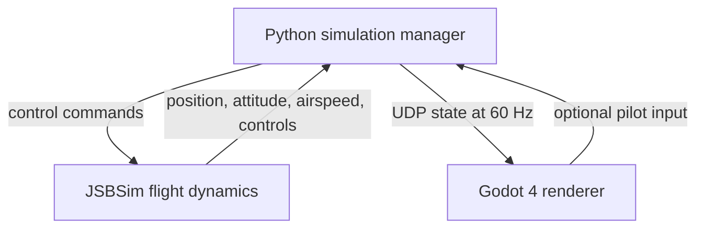

# JSBSim + Godot: Learning Roadmap for a Custom Fixed-Wing UAV Simulator

**Goal:** Learn JSBSim flight dynamics and connect it to Godot 4 for 3D visualization, eventually creating a *generic* tailless/delta-wing research UAV model.

**Recommended stack:** JSBSim (physics) + Python (control/communication) + Godot 4 (3D rendering) + optional Blender (mesh modeling).

## 1. System architecture



| Component | Responsibility | Format/language |
|---|---|---|
| JSBSim | 6-DOF aircraft physics, forces, moments, propulsion | C++ engine |
| Aircraft model | Geometry, mass/inertia, aerodynamics, controls | XML |
| Python | Fixed-step simulation and state transmission | Python |
| Godot 4 | Aircraft, terrain, cameras, telemetry UI | GDScript |
| Blender (optional) | Visual aircraft geometry | GLB/glTF |

**Design rule:** JSBSim is authoritative for flight motion. Godot displays the aircraft state; do not simultaneously simulate its flight motion using Godot rigid-body physics.

## 2. Ten-day learning plan

| Day | Topic | Deliverable |
|---|---|---|
| 1 | Install JSBSim; Python API | Run an existing aircraft and print telemetry |
| 2 | Properties and controls | Change commands, inspect pitch/roll/airspeed |
| 3 | Godot 3D basics | Aircraft mesh, ground, lighting, camera |
| 4 | UDP communication | Python transmits state, Godot receives it |
| 5 | Coordinates and attitude | Correct position/rotation in Godot |
| 6 | Visual features | Chase camera, terrain, basic telemetry HUD |
| 7 | Aircraft XML structure | Copy and modify an existing model |
| 8 | Aerodynamics and mass | One-variable-at-a-time experiments |
| 9 | Flight-control systems | Understand control mixing and surfaces |
| 10 | Generic flying-wing UAV | Custom model with plausible physics and rendering |

These are learning milestones, not fixed time estimates.

## 3. Stage 1 — Run JSBSim in Python

Ubuntu setup:

```bash
mkdir jsbsim_learning && cd jsbsim_learning
python3 -m venv .venv
source .venv/bin/activate
pip install jsbsim
```

Create `main.py`:

```python
import jsbsim

fdm = jsbsim.FGFDMExec(None)
assert fdm.load_script("scripts/c1723.xml")
assert fdm.run_ic()

fdm.set_dt(1.0 / 120.0)

for step in range(1200):
    assert fdm.run()
    if step % 120 == 0:
        print(
            f"t={fdm.get_sim_time():.2f}s "
            f"alt={fdm['position/h-sl-ft']:.0f}ft "
            f"TAS={fdm['velocities/vtrue-kts']:.1f}kt"
        )
```

Run: `python main.py`.

> Depending on the installed JSBSim version/package layout, bundled aircraft script paths may differ. If the script is not found, locate the package's `scripts` directory or set JSBSim's root directory explicitly.

Learn these APIs: `FGFDMExec`, `load_script`, `run_ic`, `set_dt`, `run`, `get_property_value` / `fdm[property]`.

**Checkpoint:** Explain why `run()` advances *simulated* time without necessarily waiting for wall-clock time.

## 4. Stage 2 — Inspect and command aircraft state

Useful JSBSim properties:

| Property | Description |
|---|---|
| `position/lat-gc-deg` | Latitude, degrees |
| `position/long-gc-deg` | Longitude, degrees |
| `position/h-sl-ft` | Altitude above sea level, feet |
| `attitude/phi-rad` | Roll, radians |
| `attitude/theta-rad` | Pitch, radians |
| `attitude/psi-rad` | Heading/yaw, radians |
| `velocities/vtrue-kts` | True airspeed, knots |
| `fcs/aileron-cmd-norm` | Normalized aileron command |
| `fcs/elevator-cmd-norm` | Normalized elevator command |
| `fcs/rudder-cmd-norm` | Normalized rudder command |
| `fcs/throttle-cmd-norm` | Normalized throttle command (where supported) |

Example (commands depend on aircraft configuration):

```python
fdm['fcs/aileron-cmd-norm'] = 0.1
fdm['fcs/elevator-cmd-norm'] = 0.0
fdm['fcs/rudder-cmd-norm'] = 0.0
fdm['fcs/throttle-cmd-norm'] = 0.6
```

**Key concept:** A control command influences control-surface deflection, then aerodynamic moments, angular acceleration, angular rate and, finally, attitude. It does not directly rotate the aircraft.

**Checkpoint:** Plot roll, pitch, airspeed and altitude as functions of simulated time.

## 5. Stage 3 — Render aircraft motion with Godot 4

### Target timing

| Task | Initial target |
|---|---:|
| JSBSim fixed physics step | 120 Hz |
| Python state publication | 60 Hz |
| Godot display | 60 FPS |
| Camera frame output (optional) | 30–60 FPS |

### Godot scene tree

```text
Main (Node3D) [attach receiver script]
├── Aircraft (Node3D)
│   └── AircraftMesh (MeshInstance3D)
├── Ground (MeshInstance3D)
├── DirectionalLight3D
└── Camera3D
```

For the first test, use a simple aircraft mesh, positioned so its nose is local `-Z`, right wing `+X`, and top `+Y`.

### Python UDP publisher (`jsbsim_server.py`)

```python
import json
import math
import socket
import time
import jsbsim

HOST, PORT = '127.0.0.1', 5005
HZ, SEND_EVERY = 120, 2
DT = 1.0 / HZ
EARTH_RADIUS_M = 6378137.0

sock = socket.socket(socket.AF_INET, socket.SOCK_DGRAM)
fdm = jsbsim.FGFDMExec(None)
assert fdm.load_script('scripts/c1723.xml')
assert fdm.run_ic()
fdm.set_dt(DT)

lat0 = fdm['position/lat-gc-deg']
lon0 = fdm['position/long-gc-deg']
alt0 = fdm['position/h-sl-ft'] * 0.3048
next_step = time.monotonic()

for i in range(HZ * 600):
    if not fdm.run():
        break

    if i % SEND_EVERY == 0:
        lat = fdm['position/lat-gc-deg']
        lon = fdm['position/long-gc-deg']
        alt = fdm['position/h-sl-ft'] * 0.3048

        # Approximate local ENU coordinates, appropriate only for small areas.
        north = math.radians(lat - lat0) * EARTH_RADIUS_M
        east = (math.radians(lon - lon0) * EARTH_RADIUS_M
                * math.cos(math.radians(lat0)))
        up = alt - alt0

        state = {
            'time': fdm.get_sim_time(),
            'east': east, 'north': north, 'up': up,
            'roll': fdm['attitude/phi-rad'],
            'pitch': fdm['attitude/theta-rad'],
            'yaw': fdm['attitude/psi-rad'],
        }
        sock.sendto(json.dumps(state).encode(), (HOST, PORT))

    next_step += DT
    sleep_sec = next_step - time.monotonic()
    if sleep_sec > 0:
        time.sleep(sleep_sec)
```

### Godot UDP receiver (attach to `Main`)

```gdscript
extends Node3D

@onready var aircraft: Node3D = $Aircraft
var udp := PacketPeerUDP.new()

func _ready() -> void:
    var err := udp.bind(5005, "127.0.0.1")
    if err != OK:
        push_error("UDP bind failed")

func _process(_delta: float) -> void:
    var latest: Dictionary = {}
    while udp.get_available_packet_count() > 0:
        var data = JSON.parse_string(
            udp.get_packet().get_string_from_utf8()
        )
        if typeof(data) == TYPE_DICTIONARY:
            latest = data

    if latest.is_empty():
        return

    # Mapping: east -> X; up -> Y; north -> -Z
    aircraft.position = Vector3(
        float(latest["east"]),
        float(latest["up"]),
        -float(latest["north"])
    )

    var roll := float(latest["roll"])
    var pitch := float(latest["pitch"])
    var heading := float(latest["yaw"])

    var yaw_basis := Basis(Vector3.UP, -heading)
    var pitch_basis := Basis(Vector3.RIGHT, pitch)
    var roll_basis := Basis(Vector3.BACK, -roll)
    aircraft.basis = yaw_basis * pitch_basis * roll_basis
```

**Coordinate validation required:** The attitude mapping above is a starter convention, not a substitute for tested frame transformations. Verify heading (north/east), positive pitch, positive roll and mesh orientation with known test states. For high-fidelity integrations, convert JSBSim's NED/body-frame orientation to Godot's frame using rotation matrices/quaternions rather than relying on Euler-angle sign assumptions. For large areas, replace the local spherical approximation with WGS84 geodetic → ECEF → ENU.

**Checkpoint:** In Godot, the plane changes position and attitude according to the JSBSim output. Add a chase camera. Later, buffer timestamped UDP states and interpolate to reduce jitter.

## 6. Stage 4 — Understand aircraft XML

| XML section | What it defines |
|---|---|
| `<metrics>` | Geometric reference dimensions |
| `<mass_balance>` | Mass, CG, inertia tensor |
| `<ground_reactions>` | Contact points/landing gear |
| `<propulsion>` | Engine and propeller definitions |
| `<flight_control>` | Control-system components and mapping |
| `<aerodynamics>` | Force/moment coefficient functions |

Learning exercises:

1. Copy an existing aircraft model into your project.
2. Change one parameter at a time, preserving a baseline.
3. Compare the resulting simulation traces.
4. Understand why changing wing geometry fields alone does **not** automatically recompute all aerodynamic coefficients.
5. Keep simulations repeatable (same initial conditions, time step, controls).

## 7. Stage 5 — Generic tailless / delta-wing UAV

After the Cessna integration works, create a *generic research flying-wing* model (not a validated replica of any particular aircraft).

- Define geometry and reference axes.
- Establish mass, CG and approximate inertia.
- Model lift, drag, stability moments and control derivatives.
- Learn elevon mixing for pitch and roll.
- Represent generic propulsion.
- Validate trim and basic flight behavior.
- Import a matching visual mesh into Godot.
- Animate control surfaces from simulated actuator states.

Note: a visually similar 3D mesh does not imply a physically accurate flight model. Aerodynamic coefficients and inertial data need credible sources or validation.

## 8. Suggested final project layout

```text
uav_simulator/
├── python/
│   ├── simulator.py
│   ├── controls.py
│   └── communication.py
├── jsbsim/
│   ├── aircraft/
│   ├── engine/
│   └── scripts/
├── godot/
│   ├── project.godot
│   ├── scenes/
│   ├── scripts/
│   └── assets/
└── README.md
```

Future extensions: controls from Godot, chase and ground cameras, terrain, flight telemetry, environmental conditions, sensor outputs for computer vision, and autopilot interfaces.

## 9. First milestone — Definition of done

- [ ] JSBSim loads an existing aircraft without errors.
- [ ] Flight dynamics run at a fixed 120 Hz step.
- [ ] Aircraft state is sent over local UDP at 60 Hz.
- [ ] Godot receives packets and moves the aircraft mesh.
- [ ] Position and attitude frame conventions are tested.
- [ ] A camera follows the airplane.
- [ ] Airspeed and altitude appear in a simple HUD.
- [ ] Manual pitch, roll and throttle commands can reach JSBSim.
- [ ] The starting Cessna model is preserved as a known-good baseline.

## 10. References

- [JSBSim GitHub](https://github.com/JSBSim-Team/jsbsim)
- [JSBSim Reference Manual](https://jsbsim-team.github.io/jsbsim-reference-manual/)
- [JSBSim Python API](https://jsbsim-team.github.io/jsbsim/python/)
- [JSBSim Aeromatic](https://jsbsim-team.github.io/aeromatic/)
- [Godot Documentation](https://docs.godotengine.org/en/stable/)
- [Godot PacketPeerUDP](https://docs.godotengine.org/en/stable/classes/class_packetpeerudp.html)

---

**Recommended next step:** Complete Day 1 before creating a custom airframe. Once Python can reliably load and advance an existing JSBSim aircraft, use the UDP/Godot milestone to establish the rendering pipeline.
