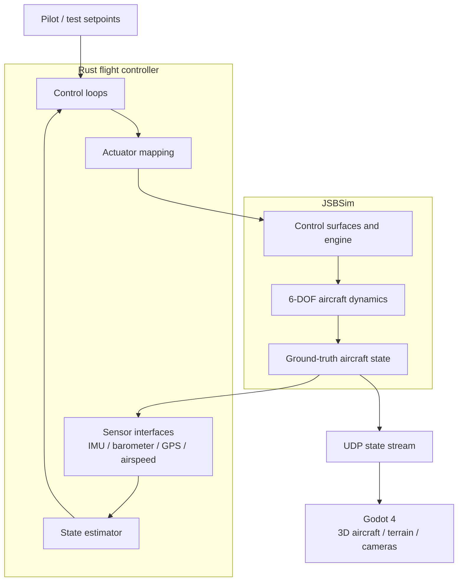
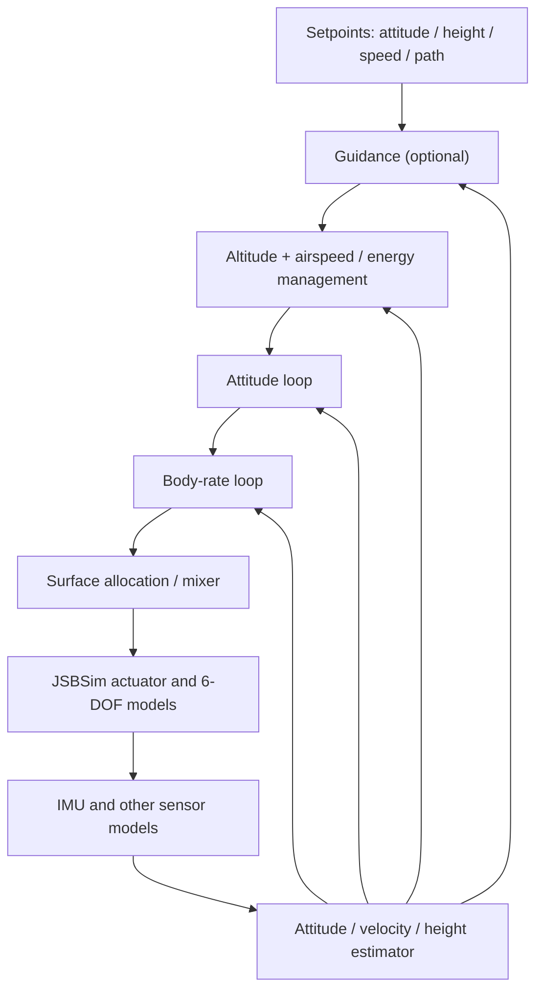
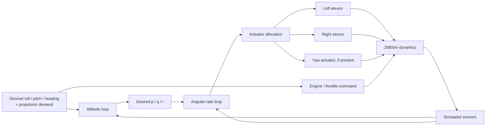

# Flight Controller Design — JSBSim + Rust + Godot

**Scope:** Educational software-in-the-loop (SITL) design for a generic fixed-wing / tailless research aircraft.  
**Stack:** JSBSim flight dynamics, Rust flight-controller software, Godot 4 visualization.  
**Date:** 2026-11-01

## 1. Overview

JSBSim is responsible for aircraft dynamics. Rust reads simulated sensors, estimates flight state, computes control requests, and writes actuator commands back to JSBSim. Godot renders the *true* simulated state and does not calculate the flight physics.



**Separation rule:** The FCU uses measurements (and estimates derived from them), while ground truth is reserved for validation and rendering.

## 2. Simulated sensors and JSBSim properties

JSBSim exposes ideal simulation quantities through named properties. These are not automatically equivalent to noisy hardware sensor outputs.

| Signal | JSBSim property | Unit | Notes |
|---|---|---|---|
| Body roll rate | `velocities/p-rad_sec` | rad/s | Ideal body angular rate |
| Body pitch rate | `velocities/q-rad_sec` | rad/s | Ideal body angular rate |
| Body yaw rate | `velocities/r-rad_sec` | rad/s | Ideal body angular rate |
| Roll angle | `attitude/phi-rad` | rad | Ground truth; use for evaluation |
| Pitch angle | `attitude/theta-rad` | rad | Ground truth; use for evaluation |
| Yaw angle | `attitude/psi-rad` | rad | Ground truth; use for evaluation |
| MSL altitude | `position/h-sl-ft` | ft | Multiply by 0.3048 for meters |
| AGL altitude | `position/h-agl-ft` | ft | Depends on terrain model |
| Vertical speed | `velocities/h-dot-fps` | ft/s | Positive upward; multiply by 0.3048 |
| Atmospheric pressure | `atmosphere/P-psf` | psf | Multiply by 47.88025898 for pascals |
| Pilot-reference acceleration | `accelerations/a-pilot-x-ft_sec2`, `...y...`, `...z...` | ft/s² | Not necessarily the same as an IMU at a different mounting position |

For a realistic IMU, define JSBSim accelerometer/gyro sensor components or a separate Rust sensor model that handles mounting location, alignment, specific force, bias, white noise, drift, filtering and sample delays. Check axes and sign conventions experimentally.

Barometric altitude is estimated from atmospheric pressure and a reference pressure; it is **not** the same as GPS altitude or AGL altitude. A six-axis IMU alone does not yield drift-free heading or absolute altitude.

## 3. Layered control design

A fixed-wing controller generally uses nested loops: navigation supplies guidance, energy/altitude control supplies flight targets, attitude control supplies body-rate targets, and the fast rate loop commands available actuators.



### Responsibilities

| Block | Typical input | Typical output |
|---|---|---|
| Sensor interface | Simulated gyro, acceleration, pressure, GPS | Timestamped calibrated measurements |
| Estimator | Sensor measurements | Estimated attitude, rates, height, velocity |
| Navigation/guidance | Position and path targets | Requested course/attitude/energy targets |
| Altitude + airspeed management | Height and speed estimates | Compatible pitch and throttle references |
| Attitude control | Desired vs. estimated attitude | Requested body angular rates |
| Rate control | Desired vs. measured body rates | Roll/pitch/yaw control demands |
| Actuator allocation | Control demands and actuator limits | Normalized commands for modeled surfaces and engine |

### RPY versus body rates

Roll **φ**, pitch **θ** and yaw **ψ** are orientation angles. Gyroscope readings **p**, **q**, **r** are rotations about *body* axes. Their time derivatives are not generally identical to Euler-angle rates. A robust attitude controller uses the appropriate Euler/body-rate kinematics or a quaternion-based attitude error.

## 4. Tailless / flying-wing considerations

A generic tailless aircraft may use two **elevons**, which combine symmetric pitch and differential roll authority. The specific sign convention and actuator effectiveness depend on aircraft geometry and XML model, so verify with static deflection and flight-dynamics tests.

Conceptual allocation:

- Pitch demand: left and right elevons deflect together.
- Roll demand: elevons deflect oppositely.
- Yaw demand: requires a modeled yaw-capable mechanism (for example rudder, differential drag, or suitable differential propulsion). Elevons by themselves do not guarantee independent yaw control.
- Engine command: separate propulsion demand, subject to engine dynamics and saturation.



**Fixed-wing constraint:** aerodynamic control authority varies with airspeed and dynamic pressure. A control design that works at one speed must not be assumed to work at every speed. Altitude and airspeed are coupled through total aircraft energy; commanding them independently without coordination can produce conflicts.

## 5. Simulation timing

Start with a single fixed-rate loop; later introduce independently scheduled loops with timestamps.

| Component | Illustrative rate |
|---|---:|
| JSBSim fixed-timestep physics | 240 Hz |
| IMU sensor model | 240 Hz |
| Angular-rate loop | 120–240 Hz |
| Attitude loop | 50–120 Hz |
| Altitude + airspeed loop | 20–50 Hz |
| GPS | 5–10 Hz |
| Godot state stream / rendering | 30–60 Hz |

These are example rates, **not** requirements or tuned controller settings. For a first prototype, one 120 Hz simulation-and-control loop is simpler.

A deterministic timestep follows:

```text
Read simulated sensors → update estimator → update due control loops
    → apply actuator commands → advance JSBSim by Δt → publish render state
    → repeat
```

If JSBSim and the controller share one Rust process through FFI, serialize access to each simulator instance. The Godot visualization process can receive periodic UDP state packets independently.

## 6. Suggested Rust project structure

```text
flight_sim/
├── Cargo.toml
├── src/
│   ├── main.rs
│   ├── simulation/
│   │   └── jsbsim.rs
│   ├── sensors/
│   │   ├── imu.rs
│   │   ├── barometer.rs
│   │   └── gps.rs
│   ├── estimation/
│   │   ├── attitude.rs
│   │   └── position.rs
│   ├── controllers/
│   │   ├── rate.rs
│   │   ├── attitude.rs
│   │   └── altitude.rs
│   ├── actuators/
│   │   └── allocation.rs
│   └── visualization/
│       └── udp.rs
└── godot/
    ├── project.godot
    └── scenes/
        └── main.tscn
```

### JSBSim integration choices

- **Native wrapper / FFI:** keeps JSBSim and Rust in the same process, allowing deterministic stepping and property access. Community wrappers should be checked for maintenance status and compatibility with your installed JSBSim.
- **JSBSim TCP interface:** keeps the processes separate but adds transport/synchronization concerns.
- **Godot UDP:** publish position/attitude at a rendering-friendly rate; Godot is not the physics authority.

## 7. Recommended incremental development and tests

| Phase | Build | Validation |
|---|---|---|
| 1 | Rust ↔ JSBSim execution, fixed dt | Repeatable state logs |
| 2 | IMU and altitude sensors | Units, frames, signs, sample rates |
| 3 | State estimator | Compare estimates to JSBSim ground truth |
| 4 | Angular-rate loop in a conventional aircraft | Controlled-rate tests in simulation |
| 5 | Attitude loop | Response to small setpoint changes |
| 6 | Altitude and airspeed estimation/control | Consistent sensor and energy behavior |
| 7 | Tailless airframe abstraction | Correct actuator direction/effectiveness |
| 8 | Godot integration | Render state matches JSBSim truth |

Use a conventional fixed-wing JSBSim model first to debug coordinate frames and sensor timing, then experiment with the custom tailless research airframe. Validate actuator saturation, sensor faults and degraded-speed conditions in simulation before drawing conclusions from nominal tests.

## 8. Useful references

- [JSBSim](https://github.com/JSBSim-Team/jsbsim)
- [JSBSim Reference Manual](https://jsbsim-team.github.io/jsbsim-reference-manual/)
- [JSBSim Python interface](https://jsbsim-team.github.io/jsbsim/python/)
- [Godot 4 documentation](https://docs.godotengine.org/en/stable/)
- [Community Rust FFI wrapper](https://github.com/jonititan/jsbsim-ffi)
- [Rust TCP client docs](https://docs.rs/jsbsimrs/latest/jsbsimrs/)

---

**Suggested first milestone:** Run JSBSim with a conventional aircraft, collect timestamped simulated gyro and altitude values in Rust, inspect the telemetry, and display ground-truth motion in Godot. Then add estimator and control blocks one at a time.
