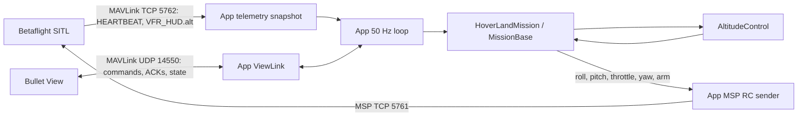
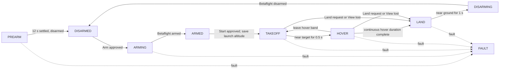

# Hover-land mission

The `hover-land` mission climbs to a configured height above its launch altitude, stays near that height for a continuous configured interval, then descends and disarms. Bullet App owns the mission state machine and throttle control. Betaflight stabilizes the vehicle from the RC commands that App sends over MSP. The current controller is tuned for SITL.

This guide describes the implementation in [the hover-land mission](../src/bullet_app/missions/hover_land.py), [the shared flight state machine](../src/bullet_app/missions/base.py), and [the App control loop](../src/bullet_app/app.py). For the complete system diagram, see [mission control loop](mission-control-loop.md).

## Start and configure

In the workspace, run **Bullet: Run hover/land mission stack (tmux)**. Its panes start the scene/SITL/renderer, Bullet App in manual `hover-land` mode, and Bullet View. Wait for View to show fresh App state, then click **Arm** and **Start hover mission**. The [workspace launcher guide](../../../workspaces/bullet_ng/launch/README.md) describes its panes and shutdown controls.

To start App separately after the SITL launcher is running:

```sh
cd /home/user/projects/bullet_app
uv run --locked bullet-app --mission hover-land --mode manual
```

The mission factory loads [the packaged profile](../src/bullet_app/missions/hover_land.yaml) once at startup:

```yaml
# Height above launch in metres; allowed 0.1–100. Loaded once at App startup.
altitude_m: 20.0
# Continuous time near the requested height in seconds; must be positive.
hover_duration_s: 10.0
```

Use `--mission-config path/to/hover_land.yaml` to load another profile. It must contain exactly `altitude_m` and `hover_duration_s`. Height must be a finite number from 0.1 to 100 m; duration must be finite and greater than zero. View displays the applied height and hover duration, but cannot change the hover-land height during a run. A profile edit takes effect when App starts again.

`--mode manual` is the default and requires View approval for Arm and Start. `--mode auto` asks App to arm when prearm completes, then to start once Betaflight confirms it is armed; it runs one attempt and exits after confirmed disarm or a fault. Auto mode does not require View. A connected View can still request Land or emergency Disarm. See [CLI options](../src/bullet_app/cli.py) and [the auto start logic](../src/bullet_app/app.py).

## Signals and control path



App requests `VFR_HUD` and `ATTITUDE` at 50 Hz. It reads the latest thread-safe telemetry snapshot on each 20 ms loop tick. `HEARTBEAT.base_mode` supplies the observed Betaflight arm state; `VFR_HUD.alt` supplies altitude. At Start, App saves the current altitude as the launch datum. The climb target is **launch datum + `altitude_m`**; the landing target is the launch datum. The hover-land path does not consume camera detections or simulator pose. [The control loop](../src/bullet_app/app.py) sends RC channels through `beta_client` MSP and publishes its own MAVLink state and fresh telemetry to View through [ViewLink](../src/bullet_app/view_link.py). The View link is separate from the Betaflight telemetry link.

Before connecting View, App queries `MSP_BOARD_INFO` and marks SITL as confirmed only when the board identifier is `SITL`. View shows the red SITL or green HW indicator from this startup check. That indicator describes the detected firmware target; it does not validate the simulator's physics connection.

## Phase sequence

`MissionBase` uses `transitions.Machine` to own the phase graph. Each control tick passes a `StepContext` containing the process-wide blackboard and monotonic time to `step()`. The blackboard holds the latest MAVLink snapshot and View liveness; `step()` checks its altitude and arm feedback, then requests a destination phase when a condition is met. The machine's ordered `resolve()` transitions allow only registered phase changes; a phase-entry callback records the new start time and performs any controller or timer reset. The sensor and timing decisions remain in the mission methods, while the machine enforces which phase changes are legal. View commands use the same path, so an accepted Arm, Start, or Land request changes phase immediately.



| Phase | App behavior and transition |
| --- | --- |
| `PREARM` | Sends disarmed, minimum-throttle RC. After 12 seconds of fresh feedback with Betaflight disarmed, becomes `DISARMED`. An already armed vehicle faults. |
| `DISARMED` | Waits for Arm in manual mode, or requests Arm in auto mode. Unexpected firmware arming faults. |
| `ARMING` | Sends arm at minimum throttle. Waits for Betaflight arm confirmation; faults after 15 seconds without it. |
| `ARMED` | Holds arm with minimum throttle. Manual mode waits for Start; auto mode requests Start. Start requires fresh finite altitude and records it as the launch datum. |
| `TAKEOFF` | Controls throttle toward launch datum plus configured height. Enters `HOVER` after being near target with low vertical speed for 0.5 seconds. |
| `HOVER` | Continues altitude hold. After the configured continuous hover interval, `HoverLandMission` enters `LAND`. If altitude or speed leaves the hover band first, it returns to `TAKEOFF` and the hover timer starts over on the next entry. |
| `LAND` | Controls throttle toward the launch datum. After staying near that altitude with low vertical speed for 1 second, enters `DISARMING`. |
| `DISARMING` | Sends disarmed, minimum-throttle RC. Returns to `DISARMED` only after Betaflight confirms disarm; faults if confirmation takes more than 10 seconds. |
| `FAULT` | Sends disarmed, minimum-throttle RC. App restart is required before another flight. |

For the default 20 m height, the hover entry band is **±0.5 m** around the target and filtered vertical speed must be at most **0.5 m/s**. The band formula is `min(0.5, max(0.03, height_m * 0.25))`, so very low configured heights use a narrower band. Landing requires altitude within **0.2 m** of the launch datum and filtered vertical speed at most **0.4 m/s**. Takeoff and landing each have a phase timeout: `max(60 s, 20 s + height / 0.5 m/s)` for takeoff and `max(60 s, 20 s + height / 0.25 m/s)` for landing. At 20 m those limits are 60 s and 100 s. See [the phase thresholds](../src/bullet_app/missions/base.py).

## Altitude controller and RC output

[AltitudeControl](../src/bullet_app/altitude_control.py) updates only when a **new** `VFR_HUD.alt` sample arrives. It estimates vertical speed from successive altitude samples and filters the estimate. Altitude error becomes a desired vertical speed, capped at 1.5 m/s upward and 0.5 m/s downward while landing. A proportional plus integral speed controller adjusts throttle around a 1400 hover estimate, clamped to RC values 1050–1650. The controller resets at initial takeoff and when landing starts. If the mission leaves `HOVER` and returns to `TAKEOFF` to regain height, it retains the controller state. For takeoffs below 1 m, it also enforces a minimum climb demand while still below target.

App puts the resulting throttle on RC channel 3 and arm on AUX1; roll, pitch, and yaw stay centered at 1500 during hover-land. Before flight, while disarming, or in fault, it sends throttle 1000 with arm low. App sends an RC command on each 50 Hz tick even if the controller has not received a new altitude sample. The attitude stream is requested and relayed for monitoring; hover-land's throttle calculation uses altitude and does not perform horizontal position hold.

## Operator actions and failure behavior

- **Arm / Start:** In manual mode, View must have a live MAVLink heartbeat and App must report the relevant ready phase. App acknowledges each accepted or denied command and View checks both the ACK and observed state. Start cannot change the profile height.
- **Land:** During takeoff or hover, View can request an early controlled descent. It follows the same landing and disarm conditions as the timed completion.
- **Disarm / emergency:** Normal Disarm is allowed from armed idle. Emergency Disarm faults the mission and sends disarmed minimum-throttle RC; it requires an App restart.
- **View heartbeat loss:** In manual mode, after 3 seconds without a View heartbeat, armed idle goes to disarming and airborne phases go to landing. Auto mode does not require View.
- **Telemetry loss:** App faults when Betaflight heartbeat is older than 3 seconds, or altitude is unavailable after the 10-second startup allowance or later older than 1 second. The mission step also rejects nonfinite or invalidly timed altitude. Unexpected arm state, phase timeouts, and missing disarm confirmation also fault.

After a normal landing, manual mode remains in `DISARMED` for another View-approved flight; the next Start captures a new launch datum. Auto mode returns success only after the attempt reaches `DISARMED`. After a fault, it returns failure when the latest Betaflight heartbeat does not indicate armed (including when no heartbeat was received). On loop exit, App tries three additional disarmed, minimum-throttle MSP sends. View reports App phase, arming/readiness, configured height and hover duration through App-originated MAVLink messages.

The safety transitions are implemented in [MissionBase](../src/bullet_app/missions/base.py), the mode and telemetry checks in [run_mission](../src/bullet_app/app.py), and the View command handling in [ViewLink](../src/bullet_app/view_link.py).
