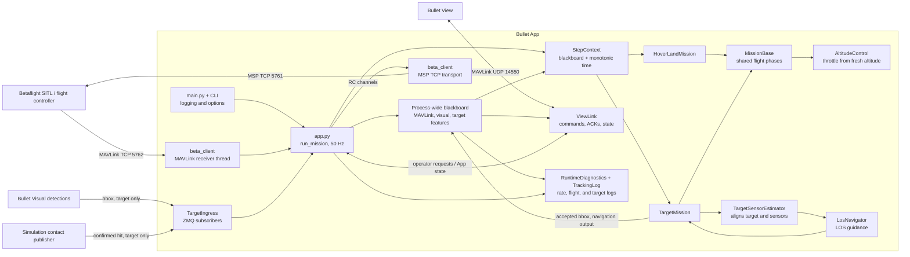
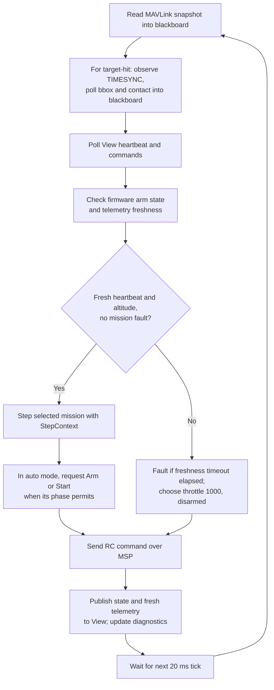

# Bullet App mission control loop

Bullet App is the controller between Betaflight and the operator. It reads Betaflight telemetry over MAVLink, chooses an RC command in a paced 50 Hz loop, and sends that command over MSP. Each Betaflight link can use TCP or serial as selected in the [connection YAML](../src/bullet_app/app.yaml); the diagram shows the default TCP ports. Bullet View provides operator requests and receives App state on a separate MAVLink link. The `target-hit` mission also consumes detector boxes and a confirmed contact event over ZeroMQ. App does not read simulator pose or other ground-truth flight feedback.

## Component relationships

`run_mission` creates one selected mission. Both implementations share `MissionBase` for arming, takeoff, altitude hold, landing, and disarming. `TargetMission` adds search, centering, settling, line-of-sight (LOS) guidance, and contact handling. The target estimator aligns timestamped camera observations with MAVLink attitude and altitude before passing them to `LosNavigator`.

`run_mission` resets the process-global `Blackboard` before creating a mission. Each tick replaces its immutable MAVLink snapshot, adds validated target observations, polls View commands, and passes `StepContext(blackboard, now_s)` to `mission.step()`. View reads current telemetry from the board; tracking diagnostics read its accepted bbox/contact data and current target navigation input/result. Source receive and capture timestamps remain attached to their data. Mission phase, timers, and the altitude controller remain on the mission; the `transitions` machine still checks legal phase changes rather than reading sensor conditions directly from the blackboard.

At startup, App also queries `MSP_BOARD_INFO` on the MSP connection and reports whether it identified a SITL firmware target in its View heartbeat. This check does not measure whether the simulator is exchanging data.

## One control tick

The MAVLink receiver runs in its own thread and updates a thread-safe snapshot. App requests `VFR_HUD` and `ATTITUDE` at 50 Hz; `target-hit` also enables `TIMESYNC`. The control loop reads the latest values without waiting for a new packet. It uses `HEARTBEAT.base_mode` to observe whether Betaflight is armed and `VFR_HUD.alt` as its altitude measurement. The shared altitude controller updates its throttle estimate only when a new altitude sample arrives.

In manual mode, View's Arm, Start, Land, and Disarm commands enter through `ViewLink.poll`; manual target missions also accept height changes while idle. View heartbeat loss makes an armed idle mission disarm or an airborne mission land. In auto mode, App requests Arm and Start itself after the shared mission reaches the appropriate phase. A target mission additionally requires fresh TIMESYNC before Arm or Start.

The loop faults if the vehicle heartbeat is older than 3 seconds or altitude remains unavailable after the 10-second startup allowance or later becomes older than 1 second. It then sends a disarmed, minimum-throttle command. `ViewLink.publish` sends App heartbeat, state, fresh attitude and relative altitude, plus status updates at their own rates; these are App-originated MAVLink messages, separate from the incoming Betaflight stream. `RuntimeDiagnostics` owns rate monitoring and periodic flight and LOS logs; `TrackingLog` records target guidance diagnostics. Neither controls flight.

## Mission paths and shutdown

- **Hover/land:** prearm settle → disarmed → arming → armed → takeoff → hover → land → disarming → disarmed. Hover completion starts landing.
- **Target-hit:** the same initial phases lead from hover to search → center → settle → LOS → commit. A confirmed contact disarms with a hit result; search or guidance failures lead to landing. Its estimator and navigator are active for the target path.
- **Shutdown:** auto mode returns after the completed attempt or fault once disarmed; manual mode remains available after a normal landing. When the loop exits, its `finally` block attempts three disarmed minimum-throttle MSP commands before closing resources.

The diagram follows [the loop](../src/bullet_app/app.py), [the shared mission state machine](../src/bullet_app/missions/base.py), [the target mission](../src/bullet_app/missions/target_hit.py), [the View link](../src/bullet_app/view_link.py), and [target input handling](../src/bullet_app/ingress.py).
