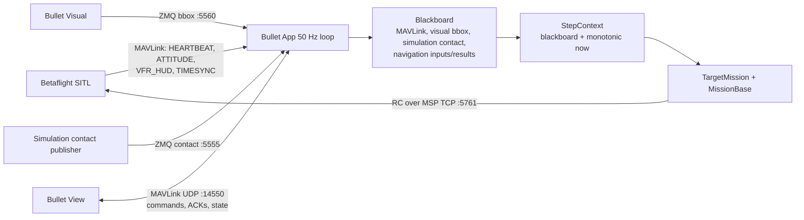
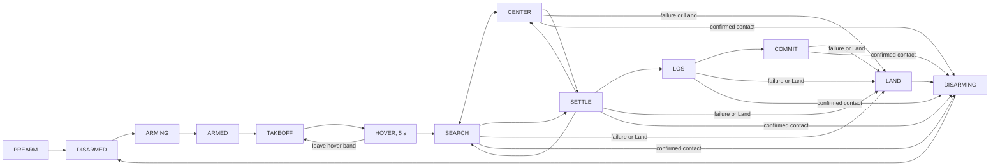

# Target-hit mission

The `target-hit` mission flies toward the red truck in the SITL scene. Bullet App arms and climbs to a height above launch, holds that height for five continuous seconds, searches for the truck, centers it in the camera, and then commands a line-of-sight (LOS) approach. **Only a validated simulator contact event confirms a hit.** A visible or large bounding box alone never does.

The mission is implemented in [TargetMission](../src/bullet_app/missions/target_hit.py), with arming, takeoff, hover, landing, and disarming shared through [MissionBase](../src/bullet_app/missions/base.py). See the [mission control loop diagram](mission-control-loop.md) for the complete App data path.

## Start and configure

Run **Bullet: Run target-hit mission stack (tmux)** in the workspace. It starts the target-enabled scene/SITL/renderer, Bullet Visual, Bullet App, and Bullet View in four panes. In the default manual mode, wait for fresh App state in View, click **Arm**, then **Start target mission**. The [workspace launcher guide](../../../workspaces/bullet_ng/launch/README.md) describes the panes and shutdown controls.

To run App after starting the target scene and Bullet Visual separately:

```sh
cd /home/user/projects/bullet_app
uv run --locked bullet-app --config src/bullet_app/app.sitl.yaml --mission target-hit --mode manual
```

`--mode auto` asks App to arm and start one attempt when its feedback and TIMESYNC gates permit; it does not require View. `--mode manual` is the default and requires View approval. Both modes allow only **one target attempt per App process**, so restart App and the launcher for another attempt. A connected View can request an early Land or emergency Disarm. See [CLI options](../src/bullet_app/cli.py) and [automatic start handling](../src/bullet_app/app.py).

The startup height defaults to **10 m above the altitude measured at Start**; the pre-search hover is fixed at **5 s**. In manual mode, View can apply a height from **0.1 to 100 m** while disarmed or armed idle, before Start. Height cannot change after Start. The `--mission-config` option selects a [LOS navigator profile](../../los_tracking/examples/bullet_profile.yaml) with camera calibration, vehicle limits, sensor freshness, and guidance tuning. Its `target_altitude_m` is a navigator setting, **not** the startup takeoff height. The View slider changes the latter without editing the profile file.

## Inputs and data ownership



On each tick, [the App loop](../src/bullet_app/app.py) places the latest immutable MAVLink snapshot on the process-wide [blackboard](../src/bullet_app/blackboard.py), polls target inputs and View commands, then calls `mission.step(StepContext(blackboard, now_s))`. The MAVLink receiver supplies locally timestamped Betaflight feedback; it does not supply simulator pose. App requests `ATTITUDE` and `VFR_HUD` at 50 Hz and enables MAVLink `TIMESYNC` for this mission. `HEARTBEAT.base_mode` supplies observed arm state and `VFR_HUD.alt` supplies altitude.

[TrackerSubscriber](../src/bullet_app/tracker.py) subscribes to detector boxes on `tracking/front/bbox`. [SimulationContactSubscriber](../src/bullet_app/simulation.py) subscribes to validated scenario contact only when `simulation.enabled: true` in YAML and target-hit is selected. The bundled [default config](../src/bullet_app/app.yaml) disables it; the [SITL config](../src/bullet_app/app.sitl.yaml) enables it. `--contact-endpoint` overrides the enabled simulation endpoint but cannot enable simulation by itself. `TargetMission.observe_bbox()` accepts only a recent packet (at most **0.2 s** old) for `camera/front/image`, `drone_1`, the configured image dimensions, a valid session and sequence, and a valid box or `null`. Accepted boxes retain their camera capture timestamp. A missing box is valid detector output and sends search back to its sweep behavior. If a packet has a frame `fid`, App forwards the accepted box to View, which overlays it only on the matching locally received image. App does not receive the camera image through this path.

The mission accepts a validated contact only for `red_truck` and `drone_1` while in Search, Center, Settle, LOS, or Commit. The blackboard keeps accepted boxes in `visual`, contact in `simulation`, and the current target navigation input/result in `features`; the estimator and phase timers remain on the mission. Contact before the target phases does not complete the mission. Without simulator contact, Commit times out after 3 seconds and lands with `contact not confirmed`.

## Flight and guidance phases



The first phases use the shared [flight state machine](../src/bullet_app/missions/base.py): a 12 s prearm settle, Arm confirmation, takeoff to the launch altitude plus applied height, and continuous hover. The height band and filtered vertical speed determine when hover starts; leaving that band returns to Takeoff and restarts the hover timer. `TargetMission._on_hover_complete()` enters Search instead of landing.

| Target phase | What App does |
| --- | --- |
| `SEARCH` | Sweeps in yaw at **15°/s** when no recent box is available. The search fails after **60 s** or one accumulated full turn without reaching LOS. |
| `CENTER` | Uses horizontal bbox-center error to command yaw toward the image center. It returns to Search if the box disappears. |
| `SETTLE` | Holds yaw at zero when horizontal error is within **10 px**. After yaw speed stays within **5°/s** for **0.3 s**, it enters LOS; renewed error or box loss returns to Center or Search. |
| `LOS` | Aligns timestamped bbox, attitude, and altitude observations; `LosNavigator` computes roll, pitch, yaw rate, and thrust demands. App converts a current valid demand into RC channels. If no current command is available, App falls back to altitude-hold throttle with centered lateral sticks. |
| `COMMIT` | Continues the navigator's close-target command path while waiting for confirmed contact. If no contact arrives within **3 s** of first Commit, the mission records failure and lands. |

The [target sensor estimator](../src/bullet_app/sensor_estimator.py) runs on a 20 ms tick. It maps Betaflight `ATTITUDE.time_boot_ms` to the host monotonic clock using accepted TIMESYNC, uses the local `VFR_HUD` receive time for barometer samples, and keeps each bbox's original capture time. The estimator aligns and briefly predicts observations for [LosNavigator](../../los_tracking/src/los_tracking/navigator.py); it does not make an old image fresh. LOS requires recent raw attitude and altitude under the selected profile's freshness limits. A navigator fault or expired approach ends guidance and starts landing.

## Completion, safety, and observation

- **Hit:** Validated contact during a target phase sets result `hit`, commands disarmed minimum-throttle RC immediately, and waits for observed disarm. The hit is based on the contact event, not detector confidence or estimated range.
- **Search or approach failure:** A full search circle or 60 s search limit records `target not found`. LOS has a **120 s** approach limit; stale raw sensors, navigator faults, or a 3 s Commit timeout also record a failure reason. These paths enter controlled landing, then disarm near the launch altitude.
- **TIMESYNC:** Arm and Start require fresh sync. If sync remains unavailable for 5 s during prearm/disarmed startup, App faults. Losing sync while arming or armed idle disarms; losing it airborne records failure and lands. Detector boxes are *not* required before Arm or Start, although View reports visual-feed freshness.
- **View and Betaflight loss:** In manual mode, losing View while armed idle disarms and losing it airborne lands. Stale Betaflight heartbeat or altitude faults the App and sends minimum-throttle disarmed RC. Emergency Disarm also faults and requires restart.

App publishes its phase, result, applied height, hover duration, arm/readiness feedback, and fresh telemetry to View over its separate MAVLink UDP link. `TargetMission` owns `TrackingLog`, which observes the RC command after App sends it. It records target-stage changes and bounded 5 Hz checkpoints, including bbox age, sensor alignment, LOS stage, guidance demand, and sent RC values; it is diagnostic output, not a control input. See [ViewLink](../src/bullet_app/view_link.py) and [tracking diagnostics](../src/bullet_app/tracking_log.py).
